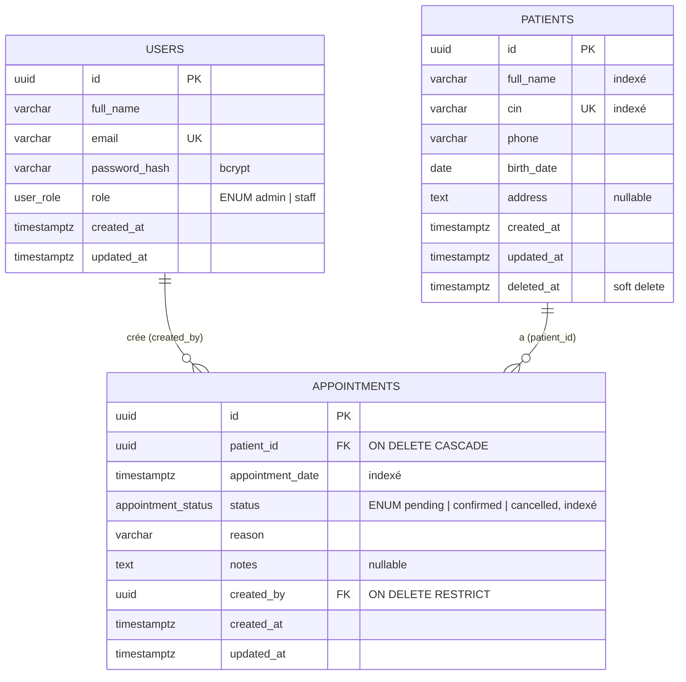

# ClinicFlow — Conception de la base de données

## ERD

## Relations

| Relation | Cardinalité | Justification |
|---|---|---|
| `patients` → `appointments` | **1-N** | Un patient a 0..N rendez-vous ; un rendez-vous concerne exactement un patient (`patient_id NOT NULL`). |
| `users` → `appointments` | **1-N** | Un utilisateur (admin/staff) crée 0..N rendez-vous ; chaque RDV garde la trace de son créateur (`created_by NOT NULL`). |

Aucune relation N-N n'est nécessaire au périmètre actuel. Le rôle est un attribut de `users` (ENUM), pas une table, car il n'y a que 2 rôles fixes.

## Règles de suppression (cascades)

- **`appointments.patient_id` → `ON DELETE CASCADE`** : un RDV n'a pas de sens sans son patient. En usage normal, l'API fait un **soft delete** (`deleted_at`) qui conserve l'historique médical ; le CASCADE ne s'applique que lors d'une purge physique (ex. droit à l'effacement), et évite alors des RDV orphelins.
- **`appointments.created_by` → `ON DELETE RESTRICT`** : on interdit de supprimer un utilisateur qui a créé des RDV, pour ne jamais perdre la traçabilité (qui a saisi quoi). Un compte doit être désactivé, pas supprimé.

## Contraintes et règles métier

- **UUID PK** (`gen_random_uuid()` via `pgcrypto`) : identifiants non devinables, exposables dans les URLs.
- **`patients.cin UNIQUE`** : un patient = une CIN.
- **ENUM Postgres** `user_role` et `appointment_status` : valeurs garanties par la base.
- **Règle des 30 minutes** — un patient ne peut pas avoir 2 RDV `confirmed` à moins de 30 min d'écart :
  1. vérifiée dans `appointment.service.js` (réponse **409** avec un message clair) ;
  2. garantie en base par une contrainte `EXCLUDE USING gist (patient_id WITH =, appointment_window(appointment_date) WITH &&) WHERE (status = 'confirmed')` (extension `btree_gist`). `appointment_window` renvoie l'intervalle `[t-15min, t+15min)` : deux intervalles se chevauchent ssi les RDV sont à moins de 30 min. Cette contrainte protège contre les créations concurrentes (race condition) que le contrôle applicatif seul ne peut pas empêcher ; l'erreur `23P01` est aussi traduite en 409.

## Index

| Index | Usage |
|---|---|
| `patients(full_name)`, `patients(LOWER(full_name))` | recherche / tri par nom |
| `patients(cin)` (+ UNIQUE) | recherche par CIN |
| `patients(deleted_at)` | filtrage des patients actifs |
| `appointments(appointment_date)` | filtre par date, RDV du jour |
| `appointments(status)` | filtre par statut, compteurs du dashboard |
| `appointments(patient_id, appointment_date)` | RDV d'un patient (page détail) et contrôle des 30 min |
| `appointments(created_by)` | FK (évite les scans lors des vérifications RESTRICT) |

> La recherche utilise `ILIKE '%…%'`. Pour un gros volume, un index trigram (`pg_trgm` + GIN) serait l'étape suivante.
